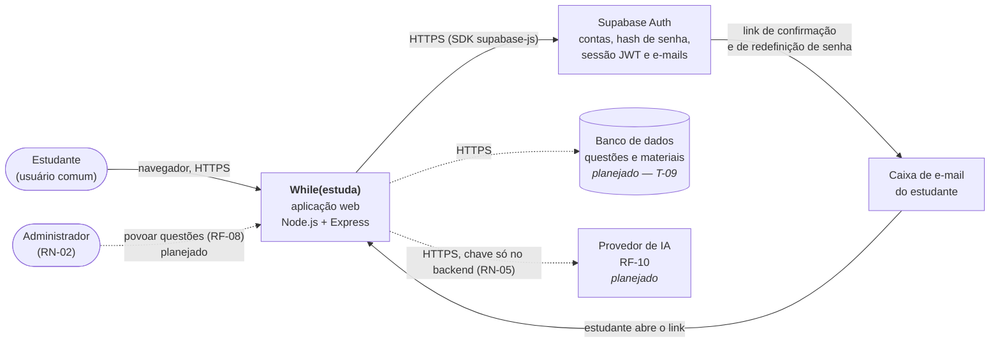
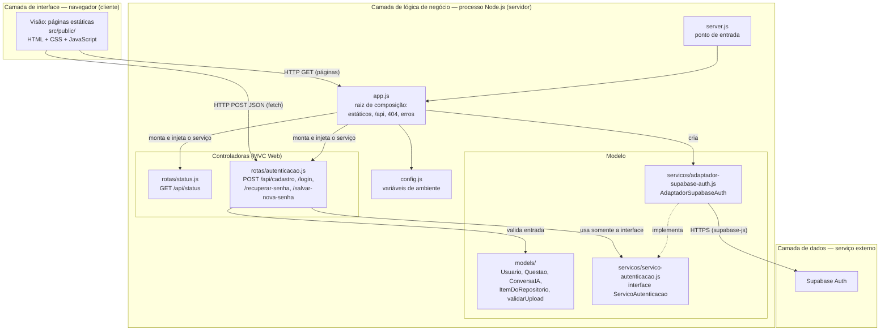
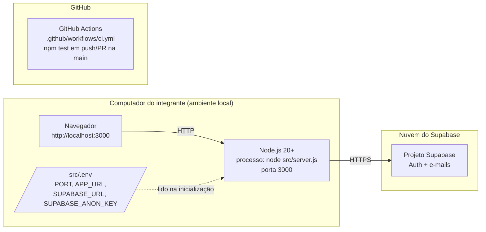

# Arquitetura de software

> **Artefato central da Sprint 6.** A arquitetura descreve a organização global da aplicação, as responsabilidades das partes e suas interações.
>
> **Última atualização:** Sprint 6 — 08/11/2026. Base conceitual: *Engenharia de Software Moderna*, cap. 7 (Valente), e slides do cap. 7 da disciplina. Os diagramas representam o código da branch `sprint-06`; elementos ainda não implementados aparecem como **planejado**, com linha tracejada.

## 1. Visão geral

### 1.1 O que entra nesta arquitetura

O cap. 7 apresenta duas formas complementares de definir arquitetura: (1) o **projeto em alto nível**, com unidades maiores que classes (camadas, pacotes, serviços); e (2) o conjunto das **decisões importantes e difíceis de reverter**. Este documento cobre as duas e registra só o que é relevante para os objetivos do While(estuda).

| "Caro mudar depois" — tratado aqui como arquitetura | "Barato mudar" — fica no código e em `decisoes-de-projeto.md` |
|---|---|
| Linguagem e plataforma do servidor (JavaScript, Node.js + Express) | Nomes de funções e variáveis |
| Onde ficam contas e senhas (Supabase Auth) e onde ficarão questões e materiais (ainda indefinido, T-09) | Algoritmo de uma validação (ex.: regra de senha em `Usuario`) |
| Monolito ou serviços separados (DA-01) | Texto das mensagens de erro |
| Divisão em camadas e quem pode depender de quem (seção 3.2) | Layout e cores das páginas |
| Formato da comunicação entre navegador e servidor (API HTTP/JSON, seção 4.2) | Organização interna de uma rota |

### 1.2 Estilo arquitetural

**Cliente/servidor em três camadas**, com o servidor implementado como um **monolito organizado internamente no estilo MVC Web**.

| Camada (cap. 7, "três camadas") | No While(estuda) | Onde está |
|---|---|---|
| **Interface com o usuário** — roda no cliente | Páginas HTML/CSS/JS no navegador; enviam requisições e mostram as respostas | [`src/public/`](../../src/public/) |
| **Lógica de negócio** — servidor de aplicação | Processo Node.js: controladoras (rotas), modelo (regras de domínio) e serviços | [`src/rotas/`](../../src/rotas/), [`src/models/`](../../src/models/), [`src/servicos/`](../../src/servicos/), montados em [`src/app.js`](../../src/app.js) |
| **Dados** — à parte | Supabase Auth (contas, hash de senha, sessão, e-mails); banco de questões e materiais planejado | Serviço externo, acessado por [`src/servicos/adaptador-supabase-auth.js`](../../src/servicos/adaptador-supabase-auth.js) |

Na analogia do restaurante usada em aula: o navegador é o cliente no salão, o servidor é a cozinha e o Supabase é a despensa. **O cliente nunca entra na despensa: fala só com o garçom.** No código, isso significa que nenhum arquivo de `src/public/` acessa o Supabase. As páginas só chamam `/api/...`, e essa regra é verificada por teste (seção 3.2).

Dentro do servidor, a organização segue o **MVC na Web**, em que a controladora trata **requisições**, e não cliques:

| Papel MVC | No servidor | Responsabilidade |
|---|---|---|
| Controladora | [`src/rotas/autenticacao.js`](../../src/rotas/autenticacao.js), [`src/rotas/status.js`](../../src/rotas/status.js) | Recebe a requisição, aciona o modelo e os serviços e escolhe o status e a mensagem |
| Modelo | [`src/models/`](../../src/models/) (regras) e [`src/servicos/`](../../src/servicos/) (acesso aos dados externos) | Regras de negócio (RN-01 a RN-05) sem nada de tela ou HTTP; por isso é testado sem subir o servidor |
| Visão | Páginas de [`src/public/`](../../src/public/) | Apresentam ao usuário o JSON devolvido pela controladora |

Diferença em relação ao MVC Web clássico (Rails, Django, Spring): aqui a visão **não é montada no servidor**. O servidor devolve JSON, e a página, já carregada no navegador, mostra o resultado com JavaScript. As páginas usam `fetch` assíncrono, como nas SPAs, mas cada tela continua sendo um arquivo HTML separado (DA-02).

### 1.3 Justificativa

- **As quatro vantagens de camadas citadas no cap. 7 aparecem no projeto:**
  - **Divide a complexidade:** cada camada tem um motivo próprio para mudar — layout em `public/`, contrato HTTP em `rotas/`, regra de negócio em `models/`, fornecedor em `servicos/`.
  - **Disciplina as dependências:** quem pode depender de quem está na seção 3.2 e é **verificado automaticamente**.
  - **Troca uma camada:** na Sprint 5, o defeito do cadastro com e-mail repetido foi corrigido só na camada de dados (adaptador), sem tocar em rotas nem telas ([padrões de projeto, 6.1](../padroes/padroes-de-projeto.md)). Trocar as páginas por uma SPA também não exigiria mudar o servidor (seção 4.2).
  - **Reúso:** as rotas de autenticação funcionam em outro app Express, recebendo o serviço por parâmetro (teste em [`tests/arquitetura.test.js`](../../tests/arquitetura.test.js)).
- **Cliente/servidor é o indicado quando** (cap. 7) os dados ficam num lugar só, muitos usuários acessam o mesmo recurso e é preciso controlar o acesso (login e permissões). As três condições valem aqui: o banco de questões é compartilhado, os materiais são de cada usuário (RN-04) e há autenticação (RF-01 a RF-03).
- **Por que monolito, e por que organizado.** No debate Tanenbaum × Torvalds, Ken Thompson resume: o monolítico "é mais fácil de fazer… e de virar bagunça". O grupo fica com o lado "mais fácil de fazer" (um processo, um deploy, ver DA-01) e combate o lado "virar bagunça" com camadas e testes de fronteira (DA-06). Até a Sprint 5, o `server.js` misturava configuração, acesso ao Supabase, rotas e inicialização no mesmo arquivo, o mesmo problema do slide "tudo misturado no clique do botão".

---

## 2. Diagrama de contexto

Mostra a aplicação como uma caixa única, as pessoas que a usam e os sistemas externos com que ela se comunica.



**Descrição:**

- **Estudante:** usa a aplicação pelo navegador. Hoje consegue se cadastrar, confirmar o e-mail, entrar e recuperar a senha (RF-01 a RF-03).
- **Administrador:** perfil previsto na RN-02 para povoar o banco de questões (RF-08). A regra existe no domínio (`Usuario.podeEditarBancoDeQuestoes()`), mas ainda não há tela nem rota.
- **Supabase Auth (implementado):** guarda as contas, gera o hash das senhas, emite a sessão e envia os e-mails de confirmação e de redefinição. É acessado **somente pelo servidor**.
- **Banco de dados (planejado):** questões, respostas e materiais (RF-04 a RF-11) ainda não são persistidos. É uma decisão "cara de mudar depois" que o grupo ainda precisa tomar (T-09).
- **Provedor de IA (planejado):** o chat do RF-10 ainda não foi implementado nem o provedor escolhido. A arquitetura já fixa que a chamada parte do servidor (RN-05) e quais padrões do cap. 7 serão reavaliados quando ele existir (seção 6).

---

## 3. Diagrama de contêineres e componentes

### 3.1 Componentes

Abre a caixa "While(estuda)" do diagrama anterior. Cada componente aponta para um arquivo ou diretório real (seção 10).



**Como ler:** as setas sólidas são chamadas reais no código; a seta tracejada `implementa` é a herança do padrão Adapter (Sprint 5). Não existe nenhuma seta da interface (navegador) para os dados (Supabase), nem das controladoras direto para o Supabase. Quem decide qual implementação de serviço usar é `app.js`.

### 3.2 Regras de dependência (verificadas automaticamente)

O cap. 7 define camadas pela regra "a camada *n* só usa a camada *n−1*" e alerta para o anti-padrão oposto, a **grande bola de lama** (*Big Ball of Mud*), em que qualquer módulo fala com qualquer outro. Os slides também observam que a IA acelera esse risco ("a tela acessa o banco direto, lógica duplicada") e recomendam **automatizar testes de arquitetura**, como o ArchUnit. As regras abaixo são verificadas a cada `npm test` por [`tests/regras-arquitetura.test.js`](../../tests/regras-arquitetura.test.js), que lê os `require` de cada arquivo:

| Regra | Por quê | Teste |
|---|---|---|
| O frontend (`public/`) só chama `/api/...`; não acessa o Supabase nem contém chaves | Interface só fala com a lógica (n → n−1); RN-05; RNF-02 | "o frontend nunca fala com o Supabase nem contém chaves" |
| O domínio (`models/`) não importa nenhuma outra camada nem biblioteca externa | O modelo não conhece tela, HTTP nem fornecedor; pode ser testado isoladamente | "domínio (models/) não depende de nenhuma outra camada" |
| Os serviços (`servicos/`) não importam `express` nem as rotas | A camada de baixo não conhece a de cima | "serviços (servicos/) não conhecem HTTP nem as rotas" |
| As rotas não importam o Supabase, o adaptador, `app.js` nem `config.js` | Controladoras dependem da interface (PP-01) e recebem o que precisam por parâmetro | "rotas não conhecem o Supabase nem o adaptador" |
| Só `app.js` cria o cliente do Supabase e escolhe o adaptador | Um único ponto de montagem (DA-04) | "só app.js (raiz de composição) cria o cliente do Supabase" |
| Variáveis de ambiente só são lidas em `config.js` | Configuração centralizada (DA-04). **Exceção documentada:** `models/usuario.js` lê `DOMINIOS_INSTITUCIONAIS` (RN-01), mantida porque os testes do domínio dependem dela | "variáveis de ambiente só são lidas em config.js" |

O teste tem um **controle positivo**: ele confirma que o analisador encontra as dependências reais, para não passar por engano. Além disso, foi verificado na Sprint 6 que ele **falha** quando se introduz um atalho. Acrescentar `require('@supabase/supabase-js')` em `rotas/status.js` e um `fetch` direto ao Supabase em `public/script.js` fez 3 testes de regras falharem; ao remover as duas linhas, todos voltaram a passar.

---

## 4. Componentes, responsabilidades e interfaces

### 4.1 Componentes

| Componente | Responsabilidade | Tecnologia | Diretório/arquivo real | Comunicação |
|---|---|---|---|---|
| Frontend (visão) | Telas de início, cadastro, login, recuperação de senha e materiais (esta ainda vazia); envio dos formulários à API | HTML, CSS, JavaScript sem framework | [`src/public/`](../../src/public/) | HTTP/JSON com a API, por `fetch`, na mesma origem |
| Ponto de entrada | Sobe o servidor HTTP na porta configurada | Node.js 20+ | [`src/server.js`](../../src/server.js) | — |
| Raiz de composição | Serve o frontend, registra as rotas, cria o Supabase e o adaptador, trata rotas inexistentes e erros | Express 4 | [`src/app.js`](../../src/app.js) | Chamadas de função entre módulos |
| Configuração | Lê `PORT`, `APP_URL`, `SUPABASE_URL` e `SUPABASE_ANON_KEY` do ambiente | `dotenv` | [`src/config.js`](../../src/config.js), [`src/.env.example`](../../src/.env.example) | — |
| Controladora de status | Informa se a aplicação está no ar e se a autenticação está configurada | Express Router | [`src/rotas/status.js`](../../src/rotas/status.js) | HTTP/JSON |
| Controladora de autenticação | Contrato HTTP do fluxo de conta (seção 4.2) | Express Router | [`src/rotas/autenticacao.js`](../../src/rotas/autenticacao.js) | HTTP/JSON; chama o domínio e a interface de serviço |
| Interface de autenticação | Operações de conta e motivos de falha no vocabulário do domínio | Classe abstrata JS | [`src/servicos/servico-autenticacao.js`](../../src/servicos/servico-autenticacao.js) | Chamada de método (`async`) |
| Adaptador do Supabase | Traduz a interface para o SDK e os erros do Supabase para motivos do domínio | `@supabase/supabase-js` 2.109 | [`src/servicos/adaptador-supabase-auth.js`](../../src/servicos/adaptador-supabase-auth.js) | HTTPS com o Supabase Auth |
| Domínio (modelo) | Regras de cadastro, senha, permissões, questões, conversa com IA e upload | JavaScript puro | [`src/models/`](../../src/models/) | Chamada de função; sem I/O |
| Testes automatizados | Verificam domínio, rotas, adaptador, comunicação entre camadas e regras de dependência | `node:test` | [`tests/`](../../tests/) | Sobem a aplicação em porta aleatória e injetam serviços falsos |

### 4.2 Interface entre cliente e servidor (API HTTP)

Todas as rotas recebem e devolvem JSON. O frontend só depende deste contrato; ele não foi alterado na reorganização da Sprint 6.

| Rota | Requisito | Corpo enviado | Respostas |
|---|---|---|---|
| `GET /api/status` | — | — | `200 { status: "ok", mensagem, servicos: { autenticacao: "configurado" \| "nao_configurado" } }` |
| `POST /api/cadastro` | RF-01, RN-01 | `{ nome, email, senha }` | `201` criada · `400` dados inválidos · `409` e-mail já cadastrado · `503` autenticação não configurada |
| `POST /api/login` | RF-02, RN-03 | `{ email, senha }` | `200 { redirecionar }` · `401` credenciais inválidas (mensagem genérica) · `403` conta não verificada · `503` |
| `POST /api/recuperar-senha` | RF-03 | `{ email }` | `200` link enviado · `400` · `503` |
| `POST /api/salvar-nova-senha` | RF-03 | `{ token_acesso, refresh_token, nova_senha }` | `200` · `400` senha fraca · `401` token inválido · `503` |
| Qualquer outra `/api/...` | — | — | `404 { sucesso: false, erro }` |
| Erro inesperado em qualquer rota | — | — | `500 { sucesso: false, erro }` genérico; detalhe só no log do servidor |

Respostas de erro seguem sempre o formato `{ sucesso: false, erro: "mensagem em português" }`, que o frontend exibe diretamente. A comunicação é **síncrona** (requisição/resposta): o cliente sempre toma a iniciativa e o servidor responde.

### 4.3 Interface entre controladoras e serviços

As rotas recebem, na montagem, uma função `obterServicoAutenticacao()` que devolve uma implementação de `ServicoAutenticacao` (ou `null`, se não houver configuração). Os métodos e o formato de resultado (`{ sucesso, motivo, detalhe }`) estão em [`padroes-de-projeto.md`](../padroes/padroes-de-projeto.md), seção 3. Essa interface é o que permite trocar a camada de dados, ou usar um serviço falso nos testes, sem mexer nas rotas.

---

## 5. Decisões arquiteturais

Registradas no formato de ADR (*Architecture Decision Record*): contexto, alternativas, decisão, consequências e evidência.

### DA-01 — Cliente/servidor em três camadas, com o servidor como um único monolito

- **Contexto:** a aplicação tem quatro áreas funcionais (conta, questões, materiais e chat com IA). Ela é feita por **um único time** de cinco estudantes, com entregas quinzenais e sem infraestrutura de operação.
- **Alternativas consideradas:**
  - **Microsserviços** (um serviço por área, cada um com processo e banco próprios). Avaliação das quatro vantagens apresentadas no cap. 7:
    - *evolução independente*: não se aplica, porque não há times diferentes com ritmos diferentes;
    - *escala fina*: não há indício de que uma área vá ser sobrecarregada isoladamente;
    - *tecnologias diferentes*: o grupo usa uma só stack;
    - *falhas parciais*: o benefício é real, mas a DA-05 obtém parte dele no monolito.
    
    Já as três desvantagens apareceriam todas: chamadas de método virariam requisições de rede (**complexidade**), haveria **latência** entre serviços e operações como "responder questão e atualizar o progresso" exigiriam **transações distribuídas**. Pela **Lei de Conway**, a arquitetura tende a copiar a organização que a constrói; um time único produz naturalmente um sistema único, e microsserviços aparecem em empresas com muitos times.
  - **Duas camadas** (interface e lógica no navegador, com as páginas falando direto com o Supabase): eliminaria o servidor, mas deixaria o cliente "pesado". As regras de negócio poderiam ser contornadas por quem manipulasse o navegador (RN-01, domínio institucional), e a futura chave de IA ficaria exposta (RN-05).
  - **Monolito sem organização interna** (a situação até a Sprint 5): é o caminho para a bola de lama descrita no cap. 7.
- **Decisão:** cliente/servidor em três camadas. O servidor é um único processo Node.js, organizado internamente em controladoras, modelo e serviços, com regras de dependência testadas (seção 3.2). Nesta sprint, `server.js` foi dividido em `config.js`, `app.js`, `rotas/status.js` e `rotas/autenticacao.js`.
- **Requisitos/atributos de qualidade:** manutenibilidade, testabilidade, RNF-03 (chamadas internas são chamadas de função, sem rede), RN-01 e RN-05 (regras e segredos no servidor).
- **Consequências e trade-offs:** um único deploy e um único `npm start`. Em contrapartida, valem os pontos fracos do monolito citados no cap. 7: mudar um módulo exige reimplantar tudo, e, se a área de questões ficar lenta, é preciso replicar o sistema inteiro. Para o volume de uso esperado, os dois são aceitáveis. Os efeitos de uma arquitetura podem levar tempo para aparecer, por isso a decisão será revista se a escala mudar.
- **Evidência no repositório:** [`src/app.js`](../../src/app.js), [`src/rotas/`](../../src/rotas/), [`tests/regras-arquitetura.test.js`](../../tests/regras-arquitetura.test.js), teste "as rotas de autenticação funcionam em outro app Express" em [`tests/arquitetura.test.js`](../../tests/arquitetura.test.js).

### DA-02 — Interface em páginas estáticas servidas pelo mesmo servidor da API

- **Contexto:** as telas atuais são formulários simples, e o grupo não adotou um framework de frontend.
- **Alternativas consideradas:**
  - (a) **SPA com framework** (ex.: React), hospedada separadamente, com atualização automática da tela (*two-way data binding*);
  - (b) **MVC Web com visão montada no servidor** (templates HTML gerados a cada requisição);
  - (c) **páginas estáticas** servidas pelo próprio Express, que buscam dados com `fetch`.
- **Decisão:** (c). O Express serve `src/public/` e a API em `/api`, na **mesma origem**.
- **Requisitos/atributos de qualidade:** RNF-01 (responsividade feita em CSS, sem depender de framework), simplicidade de implantação.
- **Consequências e trade-offs:** sem configuração de CORS, sem segundo deploy e sem etapa de build. A limitação é que telas mais dinâmicas (banco de questões, chat) exigirão mais JavaScript manual. Se isso se tornar um problema, a troca para uma SPA atinge só a camada de interface, porque o contrato da seção 4.2 independe do frontend; é a vantagem de "trocar uma camada".
- **Evidência no repositório:** [`src/app.js#L17`](../../src/app.js#L17); teste "o mesmo servidor entrega as páginas do frontend" em [`tests/arquitetura.test.js`](../../tests/arquitetura.test.js).

### DA-03 — Camada de dados de conta no Supabase Auth, acessada só pelo servidor

- **Contexto:** a RNF-02 exige hash de senha e sessão com JWT, e a RN-03 exige confirmação de e-mail. Implementar isso do zero (hash, tokens, envio de e-mail) seria caro e arriscado para a equipe. É uma decisão do tipo "encanamento": cara de mudar depois.
- **Alternativas consideradas:**
  - (a) autenticação própria com `bcrypt` e `jsonwebtoken`, mais um servidor de e-mail;
  - (b) Supabase Auth chamado direto pelo navegador (duas camadas, ver DA-01);
  - (c) Supabase Auth chamado apenas pelo servidor.
- **Decisão:** (c), implementada desde o [PR #15](https://github.com/pstehling/tp-eng-software/pull/15) e isolada atrás de uma interface na Sprint 5 (padrão Adapter, PP-01). Assim, uma eventual troca de fornecedor fica restrita a um arquivo.
- **Requisitos/atributos de qualidade:** RNF-02 (o Supabase Auth guarda as senhas com hash bcrypt), RN-01 e RN-03 (o servidor valida o domínio do e-mail antes de chamar o Supabase), segurança.
- **Consequências e trade-offs:** a aplicação depende da disponibilidade de um serviço externo em plano gratuito. Isso já causou indisponibilidade real em 26/10/2026, quando o endereço do projeto Supabase deixou de resolver (`ENOTFOUND`) e o cadastro parou até o projeto voltar (risco R-01).
- **Evidência no repositório:** [`src/servicos/`](../../src/servicos/); teste "o frontend nunca fala com o Supabase" em [`tests/regras-arquitetura.test.js`](../../tests/regras-arquitetura.test.js).

### DA-04 — Configuração por variáveis de ambiente e montagem em um único ponto

- **Contexto:** até a Sprint 5, endereços e chaves eram lidos de `process.env` dentro de `server.js`, misturados às rotas. A aplicação precisa rodar igual na máquina de cada integrante, nos testes (sem rede) e, futuramente, publicada.
- **Alternativas consideradas:**
  - (a) valores fixos no código;
  - (b) arquivo de configuração versionado;
  - (c) variáveis de ambiente lidas em um único módulo, com um arquivo de exemplo versionado.
- **Decisão:** (c). [`config.js`](../../src/config.js) é o único lugar que lê o ambiente; [`app.js`](../../src/app.js) é o único que cria serviços externos (raiz de composição). Os testes substituem serviços por `app.locals`, sem tocar no ambiente.
- **Requisitos/atributos de qualidade:** RN-05 (a futura chave de IA seguirá o mesmo caminho e nunca chegará ao navegador), segurança, portabilidade entre ambientes.
- **Consequências e trade-offs:** cada ambiente precisa de um `.env` próprio, e um `.env` errado só é percebido em execução. Por isso `/api/status` passou a informar se a autenticação está configurada, sem expor as chaves.
  - **Desvio conhecido:** `src/.env`, com chaves reais, continua versionado no git apesar do `.gitignore` (risco R-02).
  - **Exceção documentada:** `models/usuario.js` lê `DOMINIOS_INSTITUCIONAIS` (RN-01) direto do ambiente.
- **Evidência no repositório:** [`src/config.js`](../../src/config.js), [`src/.env.example`](../../src/.env.example), [`src/rotas/status.js`](../../src/rotas/status.js); teste "variáveis de ambiente só são lidas em config.js".

### DA-05 — A falha de uma requisição não derruba o servidor

- **Contexto:** o cap. 7 aponta dois pontos fracos que se aplicam aqui: no cliente/servidor, "servidor caiu? ninguém é atendido"; no monolito, "pegou fogo? fecha tudo". Na Sprint 6, verificou-se que na versão anterior isso acontecia de fato. O Express 4 não repassa exceções de funções `async` ao tratamento de erros, então uma exceção inesperada em um serviço durante o login **encerrava o processo Node.js inteiro** (código de saída 1). Além disso, uma rota `/api` inexistente respondia com a página HTML padrão do Express, que o frontend não sabe interpretar.
- **Alternativas consideradas:**
  - (a) `try/catch` em cada rota;
  - (b) migrar para o Express 5, que trata `async` nativamente;
  - (c) um invólucro `assincrona()` nas rotas e um único tratador de erros em `app.js`.
- **Decisão:** (c). A opção (a) repetiria o mesmo código em todas as rotas; a (b) exigiria trocar uma dependência central perto do fim do semestre.
- **Requisitos/atributos de qualidade:** disponibilidade e segurança (o cliente recebe uma mensagem genérica; o detalhe fica só no log do servidor).
- **Consequências e trade-offs:** toda rota nova precisa usar `assincrona()`. Os erros **esperados** (credenciais inválidas, e-mail repetido etc.) continuam tratados nas próprias rotas; o tratador central cobre só o inesperado. A solução protege contra exceções no código, não contra a queda da máquina; para isso, a saída citada no cap. 7 é ter mais servidores atrás de um balanceador de carga, o que está fora do escopo atual.
- **Evidência no repositório:** [`src/rotas/autenticacao.js#L12`](../../src/rotas/autenticacao.js#L12), [`src/app.js#L46`](../../src/app.js#L46); testes "erro inesperado no serviço vira 500 genérico e o servidor continua no ar" e "rota inexistente da API responde 404 em JSON" em [`tests/arquitetura.test.js`](../../tests/arquitetura.test.js).

### DA-06 — Regras de arquitetura verificadas por testes automatizados

- **Contexto:** o cap. 7 destaca que, com IA, o código é produzido mais rápido e "a lama cresce mais rápido". Cada pedido resolve um problema local, sem olhar o todo, e os atalhos típicos são "a tela acessa o banco direto" e "lógica duplicada". O grupo usa ferramentas de IA no desenvolvimento, e as fronteiras desta arquitetura, até agora, existiam só no documento.
- **Alternativas consideradas:**
  - (a) confiar na revisão manual dos PRs;
  - (b) adotar uma ferramenta de análise de dependências de terceiros;
  - (c) um teste próprio, com `node:test`, que lê os `require` de cada arquivo e verifica as regras da seção 3.2.
- **Decisão:** (c). Segue a recomendação do checklist do cap. 7 ("automatize: testes de arquitetura, ex.: ArchUnit") sem acrescentar dependências, e roda junto com os demais testes, inclusive no CI.
- **Requisitos/atributos de qualidade:** manutenibilidade; RNF-02 e RN-05 (nenhuma chave ou acesso a dados no frontend).
- **Consequências e trade-offs:** a análise é textual (procura `require(...)` e `fetch(...)`), então não detecta dependências criadas por caminhos dinâmicos. Uma regra nova exige editar o teste. Em troca, uma violação das fronteiras aparece como teste falhando antes do merge.
- **Evidência no repositório:** [`tests/regras-arquitetura.test.js`](../../tests/regras-arquitetura.test.js); verificação de que o teste falha com atalhos introduzidos (seção 3.2).

---

## 6. Outros estilos do cap. 7 avaliados e não adotados

| Estilo | Quando o cap. 7 indica | Situação no While(estuda) |
|---|---|---|
| **Microsserviços** | Muitos times, partes que precisam escalar ou ser implantadas de forma independente | Não adotado (DA-01) |
| **Fila de mensagens** (assíncrona, um consumidor) | Produtor que não precisa esperar o consumidor; desacoplamento no tempo | Nenhum fluxo atual precisa disso. **A reavaliar no RF-10:** os slides indicam fila assíncrona quando "a resposta do modelo demora segundos" |
| **Publish/Subscribe** (evento para vários assinantes) | Vários sistemas reagindo ao mesmo fato | Hoje nenhum evento tem mais de um interessado. Candidato futuro: "questão respondida" atualizar histórico e progresso (RF-04, RF-09) |
| **Pipes e filtros** | Cadeia de transformações de dados | Não há processamento em etapas |
| **Peer-to-peer** | Todos os nós são cliente e servidor | Não se aplica: dados centralizados e controle de acesso exigem servidor |

Para o chat com IA (RF-10), os slides indicam ainda o tratamento de **falha parcial** (provedor do modelo fora do ar). Pela DA-01 e pela DA-05, a ideia é que uma falha do provedor de IA afete só o chat e não o resto da aplicação. Isso deverá ser verificado quando o RF-10 for implementado.

---

## 7. Requisitos não funcionais e decisões arquiteturais

| RNF | O que exige | Decisão que responde | Situação atual | Como será verificado |
|---|---|---|---|---|
| **RNF-01** — Usabilidade/acessibilidade | Layout de 360 px a 1920 px, contraste e navegação por teclado | DA-02: interface em HTML/CSS, sem dependência de framework | **Parcial:** as páginas usam [`style.css`](../../src/public/style.css), mas responsividade e acessibilidade ainda não foram auditadas | Lighthouse e DevTools — Sprint 7 |
| **RNF-02** — Segurança | Senhas com hash e rotas privadas protegidas por JWT | DA-01 e DA-03: regras e dados só no servidor; Supabase Auth (hash bcrypt, JWT); DA-04: segredos fora do código; DA-06: frontend sem chaves (testado) | **Parcial:** o hash está atendido. **Não atendido:** o login não devolve nem guarda a sessão, e não existe rota privada protegida (`materiais.html` é pública). Débito T-08 | Teste de integração: requisição sem token deve receber 401 |
| **RNF-03** — Desempenho | Listagem e filtro de questões em até 2,0 s | DA-01: chamadas internas sem rede; filtro no domínio (`Questao.filtrar`) | **Não verificável ainda:** a listagem e a persistência não existem (T-09) | Teste de tempo de resposta da API — Sprint 7 |
| **RNF-04** — Armazenamento | Upload PDF/PNG/JPG/TXT até 50 MB | Regra no modelo ([`validarUpload`](../../src/models/materiais.js)); a rota de upload será uma nova controladora em `rotas/` | **Parcial:** a regra existe e é testada; a rota e o armazenamento não existem | Testes do domínio (já existem) e de integração da rota futura |

---

## 8. Implantação e execução

### 8.1 Visão de implantação atual



A aplicação ainda **não está publicada**: hoje ela roda na máquina de cada integrante, todos usando o mesmo projeto Supabase. A escolha da hospedagem está pendente com o grupo (T-10). Como o servidor é um único processo e serve também as páginas, a publicação exige **um único serviço** que rode `npm start` e receba as variáveis da seção 8.3. Ao publicar, é preciso:

- cadastrar o endereço público no Supabase (*Authentication > URL Configuration*);
- informá-lo em `APP_URL`, senão os links enviados por e-mail apontam para `localhost`.

### 8.2 Ambientes

| Ambiente | Endereço ou comando | Finalidade |
|---|---|---|
| Local | `npm run instalar` e depois `npm start` (na raiz do repositório) → http://localhost:3000 | Desenvolvimento e demonstração |
| Testes automatizados | `npm test` (na raiz ou em `src/`) | Comportamento e regras de arquitetura, sem rede e sem `.env` |
| Integração contínua | [`.github/workflows/ci.yml`](../../.github/workflows/ci.yml) | Roda os testes a cada push ou PR na `main` |
| Publicado | **Ainda não existe** (T-10) | Demonstração para o professor e para o vídeo final |

### 8.3 Instruções de execução

Pré-requisito: Node.js 20 ou superior.

```bash
# na raiz do repositório
npm run instalar          # instala as dependências de src/
cp src/.env.example src/.env
# edite src/.env e preencha SUPABASE_URL e SUPABASE_ANON_KEY (Supabase > Settings > API)
npm start                 # http://localhost:3000
npm test                  # testes automatizados
```

Os mesmos comandos continuam funcionando de dentro de `src/` (`npm install`, `npm start`, `npm test`). O [`package.json`](../../package.json) da raiz foi criado nesta sprint porque executar `npm start` na raiz resultava em erro `ENOENT` (o projeto Node.js fica em `src/`).

| Variável | Obrigatória | Uso |
|---|---|---|
| `PORT` | Não (padrão 3000) | Porta HTTP do servidor |
| `APP_URL` | Não (padrão `http://localhost:PORT`) | Endereço público usado nos links de confirmação e de redefinição de senha |
| `SUPABASE_URL` | Sim, para cadastro e login | Endereço do projeto Supabase |
| `SUPABASE_ANON_KEY` | Sim, para cadastro e login | Chave pública (anon) do projeto Supabase |
| `DOMINIOS_INSTITUCIONAIS` | Não | Lista de domínios aceitos no cadastro (RN-01) |

**Verificação rápida:** `GET http://localhost:3000/api/status` deve responder `"status": "ok"` e `"autenticacao": "configurado"`. Se aparecer `"nao_configurado"`, o `.env` não foi encontrado ou está incompleto.

---

## 9. Riscos arquiteturais

| ID | Risco | Probabilidade | Impacto | Mitigação | Item do backlog |
|---|---|---|---|---|---|
| R-01 | Indisponibilidade ou pausa do projeto Supabase (plano gratuito); já ocorreu em 26/10/2026 | Média | Alta: cadastro, login e recuperação param | Adaptador isola o fornecedor (DA-03); `/api/status` ajuda a diagnosticar; diferenciar falha de rede de credencial inválida (T-06) | T-06 |
| R-02 | Chaves reais do Supabase versionadas em `src/.env` desde o commit `aeaabd1` | Já ocorrido | Alta: qualquer pessoa com acesso ao repositório usa o projeto | Tirar o arquivo do versionamento e gerar chaves novas no painel do Supabase | T-11 |
| R-03 | Rotas privadas sem proteção (RNF-02 não atendido) | Alta | Alta quando houver dados pessoais (materiais, RN-04) | Middleware em `rotas/` que valide o JWT do Supabase antes das rotas privadas | T-08 |
| R-04 | Persistência de questões e materiais indefinida (decisão "cara de mudar depois") | Alta | Média: bloqueia RF-04 a RF-11 | Decidir a tecnologia e acessá-la por uma interface em `servicos/`, como na autenticação | T-09 |
| R-05 | Aplicação não publicada até a entrega final | Média | Média: a demonstração dependeria de uma máquina local | Escolher hospedagem e publicar antes da Sprint 8 | T-10 |
| R-06 | Erosão da arquitetura (bola de lama), acelerada pelo uso de IA | Média | Alta a longo prazo | Regras de dependência testadas a cada `npm test` (DA-06); revisar dependências nos PRs, e não só "se funciona" | — |

---

## 10. Correspondência arquitetura × código

| Elemento do diagrama | Evidência no código/configuração |
|---|---|
| Interface (páginas estáticas) | [`src/public/`](../../src/public/) — chamadas `fetch('/api/...')` em [`login/script.js`](../../src/public/login/script.js), [`cadastro/script.js`](../../src/public/cadastro/script.js), [`recuperar-senha/script.js`](../../src/public/recuperar-senha/script.js) |
| `server.js` (entrada) | [`src/server.js`](../../src/server.js) |
| `app.js` (raiz de composição) | [`src/app.js`](../../src/app.js) — estáticos (L17), criação do Supabase (L23), escolha do serviço (L35), rotas (L42–43), 404 (L46), erros (L53) |
| `config.js` | [`src/config.js`](../../src/config.js), [`src/.env.example`](../../src/.env.example) |
| Controladora de status | [`src/rotas/status.js`](../../src/rotas/status.js) |
| Controladora de autenticação | [`src/rotas/autenticacao.js`](../../src/rotas/autenticacao.js) — cadastro (L25), login (L59), recuperação (L83), nova senha (L106) |
| Interface `ServicoAutenticacao` | [`src/servicos/servico-autenticacao.js`](../../src/servicos/servico-autenticacao.js) |
| `AdaptadorSupabaseAuth` | [`src/servicos/adaptador-supabase-auth.js`](../../src/servicos/adaptador-supabase-auth.js) |
| Modelo (domínio) | [`src/models/`](../../src/models/) |
| Camada de dados (Supabase Auth) | dependência `@supabase/supabase-js` em [`src/package.json`](../../src/package.json); configuração em `src/.env` |
| Regras de dependência | [`tests/regras-arquitetura.test.js`](../../tests/regras-arquitetura.test.js) |
| Comunicação entre as partes | [`tests/arquitetura.test.js`](../../tests/arquitetura.test.js) |
| Execução a partir da raiz | [`package.json`](../../package.json) |
| Integração contínua | [`.github/workflows/ci.yml`](../../.github/workflows/ci.yml) |

---

## 11. Antes e depois da reorganização (Sprint 6)

| Aspecto | Antes (`53f0ae0`, fim da Sprint 5) | Depois (`sprint-06`) |
|---|---|---|
| Organização do servidor | [`src/server.js`](https://github.com/pstehling/tp-eng-software/blob/53f0ae07dcdf9502837b602c08c7687af18d127d/src/server.js) com 178 linhas: leitura do `.env`, criação do Supabase, 4 rotas, status e inicialização | `server.js` só inicia; `app.js` monta; `config.js` configura; `rotas/` são as controladoras |
| Fronteiras entre camadas | Só no texto da documentação | Verificadas a cada `npm test` (7 testes de regras) |
| Onde as rotas obtêm o serviço | Funções globais de `server.js` | Recebido por parâmetro na montagem (`criarRotasAutenticacao({ obterServicoAutenticacao, urlAplicacao })`) |
| Exceção inesperada em um serviço | Processo encerrado; aplicação fora do ar para todos | Resposta `500` genérica; servidor continua atendendo |
| Rota `/api` inexistente | Página HTML padrão do Express | `404` em JSON |
| Diagnóstico da configuração | Só tentando cadastrar ou entrar | `GET /api/status` informa se a autenticação está configurada |
| Executar a partir da raiz | `npm start` falhava com `ENOENT` | `npm start`, `npm test` e `npm run instalar` funcionam |
| Contrato HTTP com o frontend | — | **Inalterado**; nenhum arquivo de `src/public/` foi modificado |
| Testes | 45 aprovados ([saída](../evidencias/sprint-06-testes-antes.txt)) | 58 aprovados: os 45 anteriores **sem alteração**, 6 de comunicação e 7 de regras de arquitetura ([saída](../evidencias/sprint-06-testes-depois.txt)) |
