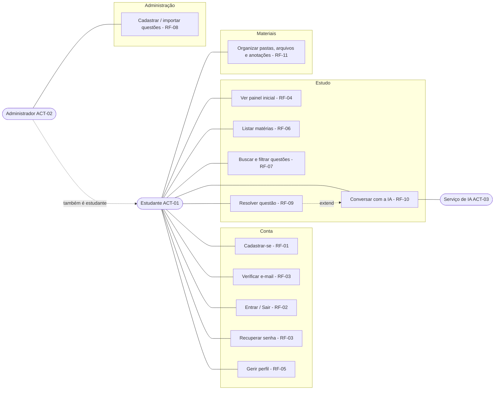
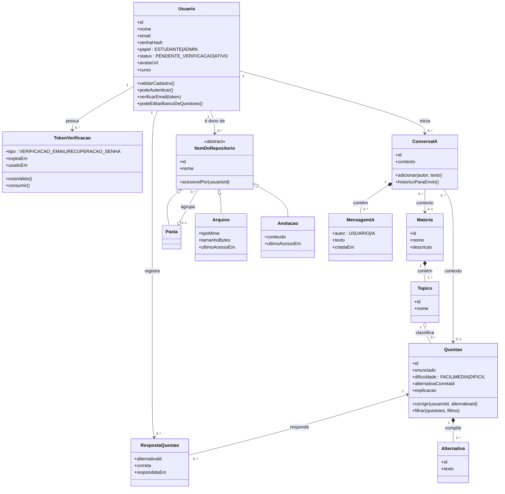
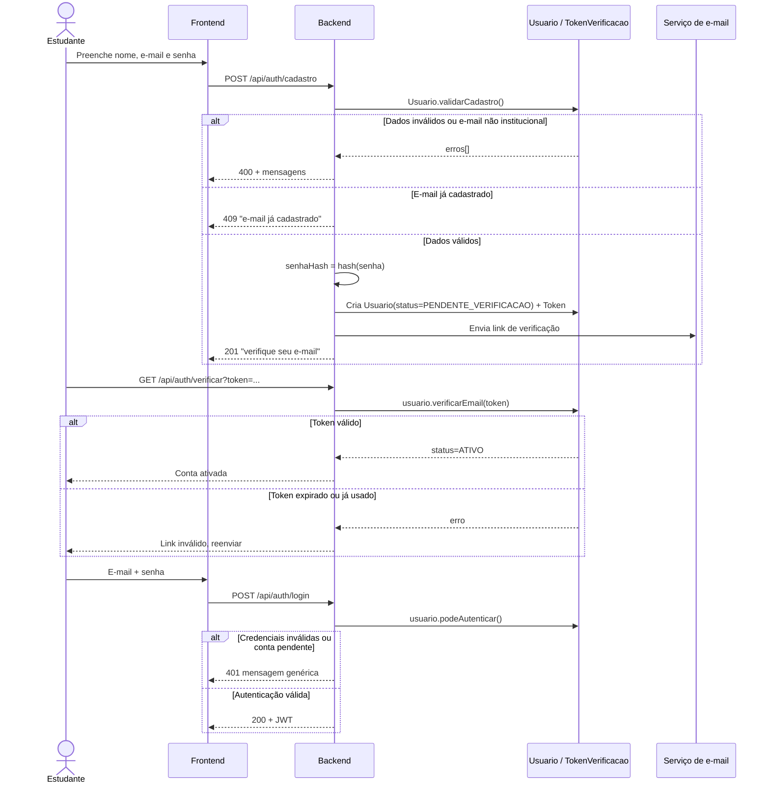
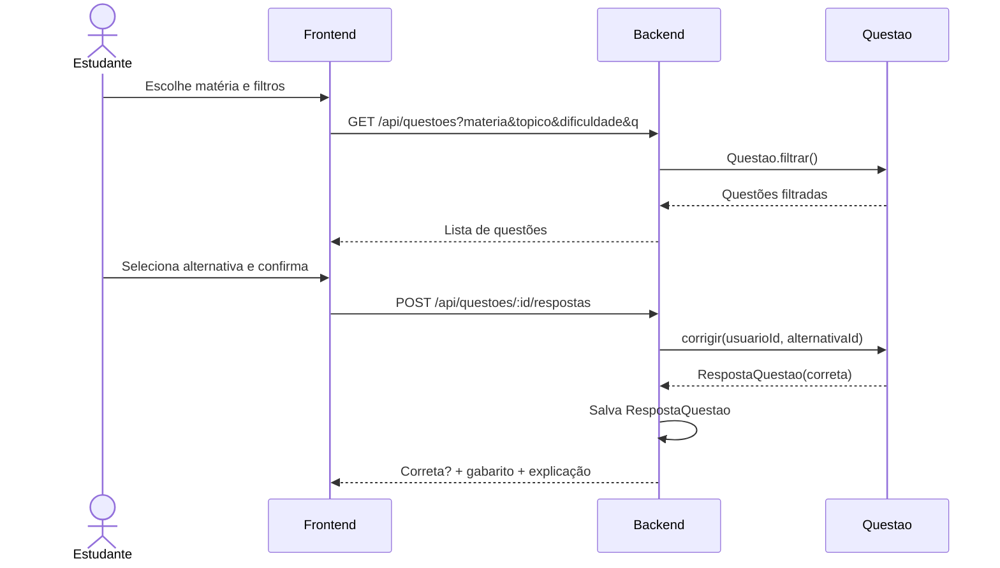
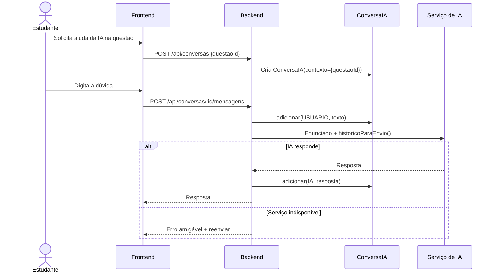
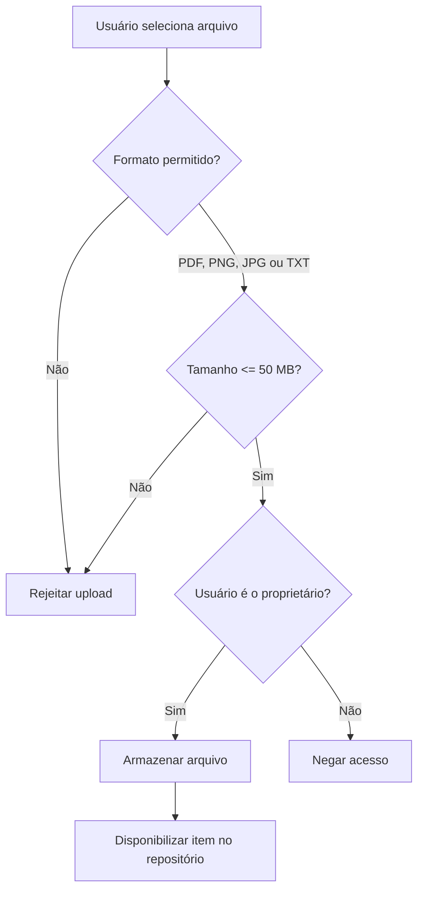
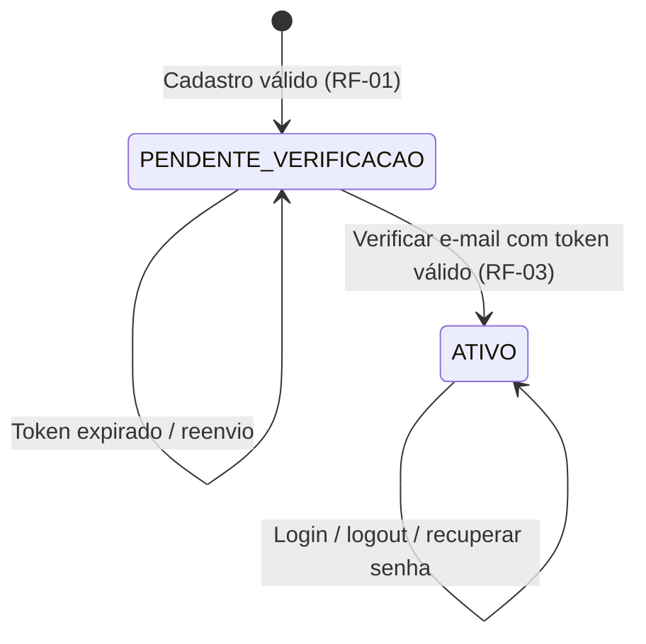

# Modelagem do sistema

> **Artefato central da Sprint 3.** Os modelos explicam a estrutura e o comportamento da solução e estabelecem a correspondência entre requisitos, regras de negócio e código.

## 1. Modelos selecionados

| Modelo                         | Tipo           | Pergunta que ele ajuda a responder                                                              | Requisitos relacionados                   |
| ------------------------------ | -------------- | ----------------------------------------------------------------------------------------------- | ----------------------------------------- |
| Casos de uso                   | Comportamental | Quem utiliza o sistema e quais funcionalidades cada ator pode executar?                         | RF-01 a RF-11                             |
| Classes / entidades de domínio | Estrutural     | Quais são as entidades do sistema, seus atributos e como elas se relacionam?                    | RF-01 a RF-11, RN-01 a RN-05              |
| Cadastro, verificação e login  | Comportamental | Como ocorre o cadastro, a verificação do e-mail e a autenticação?                               | RF-01, RF-02, RF-03, RN-01, RN-03, RNF-02 |
| Resolver questão               | Comportamental | Como uma questão é filtrada, respondida, corrigida e registrada no histórico?                   | RF-07, RF-09, RNF-03                      |
| Dúvida com IA                  | Comportamental | Como o estudante envia uma dúvida e recebe uma resposta do serviço externo de IA?               | RF-10, RN-05                              |
| Regras de upload de materiais  | Comportamental | Quais arquivos podem ser enviados e quais regras de acesso e armazenamento devem ser aplicadas? | RF-11, RN-04, RNF-04                      |
| Estados do usuário             | Comportamental | Quais estados uma conta pode assumir e como ocorre a transição entre eles?                      | RF-03, RN-03                              |

---

## 2. Modelo de casos de uso

O modelo representa os atores e as funcionalidades disponíveis no sistema.

O `Estudante (ACT-01)` realiza as operações relacionadas à conta, estudo e materiais. O `Administrador (ACT-02)` também possui as funcionalidades de estudante e, adicionalmente, pode cadastrar ou importar questões. O `Serviço de IA (ACT-03)` é um ator externo acionado pelo caso de uso de conversação com a IA.

**Descrição e decisões representadas:** o administrador é tratado como um estudante com permissões adicionais, em vez de possuir um conjunto completamente separado de funcionalidades. O serviço de IA permanece como ator externo e é acionado somente pela funcionalidade de conversação com a IA.

---

## 3. Modelo estrutural de classes e entidades

O modelo de classes representa a estrutura lógica do domínio. A persistência ainda é independente de SGBD, conforme definido para a Sprint 3.

### 3.1 Diagrama de classes

**Descrição e decisões representadas:**

* `Usuario` possui o atributo `papel`, permitindo representar estudantes e administradores em uma única entidade.
* `Topico` é uma entidade própria porque as matérias possuem tópicos associados e as questões podem ser filtradas por assunto.
* `RespostaQuestao` é uma entidade própria porque o sistema precisa manter o histórico das respostas e utilizá-lo para representar o progresso de estudos.
* `Pasta`, `Arquivo` e `Anotacao` herdam de `ItemDoRepositorio`, centralizando as regras relacionadas ao proprietário e ao acesso aos materiais.
* `TokenVerificacao` representa tanto a verificação de e-mail quanto a recuperação de senha, diferenciadas pelo atributo `tipo`.
* `ConversaIA` pode manter contexto relacionado a uma questão ou matéria.
* A chave da API de IA não pertence ao modelo de domínio e deve permanecer na configuração do backend.

---

## 4. Modelos comportamentais

### 4.1 Cadastro, verificação e login

O fluxo representa o processo necessário para liberar o acesso às telas privadas do sistema.

As principais decisões são: utilizar uma mensagem genérica para falhas de login, impedir a autenticação de contas que ainda não verificaram o e-mail e manter hash de senha e JWT na camada de serviço.

**Descrição e decisões representadas:** o cadastro cria inicialmente uma conta com status `PENDENTE_VERIFICACAO`. Após a validação do token, a conta passa para `ATIVO`. O login só é permitido quando a conta pode ser autenticada. O tratamento de senha e JWT permanece fora do modelo de domínio.

---

### 4.2 Resolver questão

Esse é o fluxo central de estudo. A questão é filtrada, respondida e corrigida no domínio por `Questao.corrigir()`. O resultado gera uma `RespostaQuestao`, utilizada posteriormente para histórico e progresso.

**Descrição e decisões representadas:** a filtragem considera matéria, tópico, dificuldade e busca textual. A correção é responsabilidade da entidade `Questao`, enquanto `RespostaQuestao` registra a resposta do estudante para formar o histórico e contribuir para o progresso.

---

### 4.3 Dúvida com IA

O fluxo representa a integração com o serviço externo de IA. Apenas o backend realiza a comunicação com o provedor, mantendo a chave da API no servidor. Em caso de indisponibilidade, o sistema apresenta uma mensagem amigável e permite uma nova tentativa.

**Descrição e decisões representadas:** `ConversaIA` mantém o histórico da interação e pode guardar o contexto da questão. A comunicação com o serviço externo acontece exclusivamente pelo backend.

---

### 4.4 Regras de upload de materiais

O upload de materiais possui regras específicas de formato, tamanho e acesso. São aceitos arquivos `PDF`, `PNG`, `JPG` e `TXT`, com limite máximo de `50 MB`. O acesso ao item é permitido somente ao seu proprietário.

**Descrição e decisões representadas:** a validação do upload deve garantir os formatos permitidos e o limite máximo de 50 MB. A regra de privacidade determina que somente o proprietário tenha acesso ao item. A implementação está associada a `src/models/materiais.js` e aos testes em `tests/models.test.js`.

---

### 4.5 Estados do usuário

O ciclo de vida da conta é representado pelos estados `PENDENTE_VERIFICACAO` e `ATIVO`.

**Descrição e decisões representadas:** uma conta criada corretamente inicia como `PENDENTE_VERIFICACAO`. A verificação de um token válido altera seu estado para `ATIVO`. Um token expirado não ativa a conta, sendo necessário realizar o reenvio.

---

## 5. Relação entre requisitos e modelos

| Requisito | Elemento do modelo                                     | Como está representado                                                    | Alteração provocada no backlog/código |
| --------- | ------------------------------------------------------ | ------------------------------------------------------------------------- | ------------------------------------- |
| RF-01     | `Usuario.validarCadastro()`                            | Cadastro e validação de dados no modelo de domínio e no fluxo de cadastro | `src/models/usuario.js`               |
| RF-02     | `Usuario.podeAutenticar()`                             | Fluxo de login e autenticação                                             | `src/models/usuario.js`               |
| RF-03     | `TokenVerificacao` / `verificarEmail()`                | Verificação de e-mail e recuperação de senha                              | `src/models/usuario.js`               |
| RF-04     | `RespostaQuestao`                                      | Histórico e progresso de estudos                                          | `src/models/questao.js`               |
| RF-05     | `Usuario`                                              | Dados e gerenciamento do perfil                                           | `src/models/usuario.js`               |
| RF-06     | `Materia` / `Topico`                                   | Organização das matérias e tópicos                                        | `src/models/questao.js`               |
| RF-07     | `Questao.filtrar()`                                    | Busca e filtros de questões                                               | `src/models/questao.js`               |
| RF-08     | `Questao` / `Alternativa`                              | Cadastro e validação de questões                                          | `src/models/questao.js`               |
| RF-09     | `Questao.corrigir()` / `RespostaQuestao`               | Resolução, correção e histórico                                           | `src/models/questao.js`               |
| RF-10     | `ConversaIA` / `MensagemIA`                            | Conversação com o serviço externo de IA                                   | `src/models/conversa.js`              |
| RF-11     | `ItemDoRepositorio` / `Pasta` / `Arquivo` / `Anotacao` | Organização e gerenciamento de materiais                                  | `src/models/materiais.js`             |
| RN-01     | `Usuario.validarCadastro()`                            | Validação do e-mail institucional                                         | `src/models/usuario.js`               |
| RN-02     | `Usuario.podeEditarBancoDeQuestoes()`                  | Permissão adicional do administrador                                      | `src/models/usuario.js`               |
| RN-03     | `Usuario.status` / `TokenVerificacao`                  | Conta pendente ou ativa                                                   | `src/models/usuario.js`               |
| RN-04     | `ItemDoRepositorio.acessivelPor()`                     | Acesso aos materiais somente pelo proprietário                            | `src/models/materiais.js`             |
| RN-05     | `ConversaIA`                                           | Comunicação com IA realizada pelo backend                                 | `src/models/conversa.js`              |
| RNF-02    | Fluxo de cadastro/login                                | Hash de senha e JWT tratados na camada de serviço                         | Backend                               |
| RNF-03    | `Questao.filtrar()`                                    | Busca e filtragem de questões                                             | `src/models/questao.js`               |
| RNF-04    | `validarUpload()`                                      | Formatos e limite de tamanho dos arquivos                                 | `src/models/materiais.js`             |

---

## 6. Correspondência entre modelo e código

| Elemento modelado   | Arquivo/diretório correspondente | Observação                                                                         |
| ------------------- | -------------------------------- | ---------------------------------------------------------------------------------- |
| `Usuario`           | `src/models/usuario.js`          | Concentra validações de cadastro, autenticação, verificação de e-mail e permissões |
| `TokenVerificacao`  | `src/models/usuario.js`          | Representa tokens de verificação e recuperação de senha                            |
| `Materia`           | `src/models/questao.js`          | Representa as matérias utilizadas na organização das questões                      |
| `Topico`            | `src/models/questao.js`          | Representa os tópicos associados às matérias                                       |
| `Questao`           | `src/models/questao.js`          | Contém filtragem e correção das questões                                           |
| `Alternativa`       | `src/models/questao.js`          | Representa as alternativas das questões                                            |
| `RespostaQuestao`   | `src/models/questao.js`          | Registra respostas, acertos e histórico                                            |
| `ConversaIA`        | `src/models/conversa.js`         | Mantém o contexto e histórico da conversa                                          |
| `MensagemIA`        | `src/models/conversa.js`         | Representa mensagens enviadas pelo usuário ou pela IA                              |
| `ItemDoRepositorio` | `src/models/materiais.js`        | Abstração compartilhada dos itens do repositório                                   |
| `Pasta`             | `src/models/materiais.js`        | Organização dos materiais                                                          |
| `Arquivo`           | `src/models/materiais.js`        | Armazenamento de arquivos enviados                                                 |
| `Anotacao`          | `src/models/materiais.js`        | Representa anotações do usuário                                                    |
| Validação de upload | `src/models/materiais.js`        | Implementa as regras de formato, tamanho e acesso                                  |
| Testes dos modelos  | `tests/models.test.js`           | Verificação automatizada dos modelos e regras                                      |

---

## 7. Refinamentos identificados

* `Usuario` foi utilizado como entidade única para estudantes e administradores, diferenciados pelo atributo `papel`.
* `Topico` foi separado de `Materia` para representar os tópicos associados e permitir filtragem por assunto.
* `RespostaQuestao` foi criada como entidade própria para suportar histórico de respostas e progresso de estudos.
* `ItemDoRepositorio` foi definido como abstração para centralizar regras compartilhadas entre pastas, arquivos e anotações.
* `TokenVerificacao` passou a representar tanto a verificação de e-mail quanto a recuperação de senha, diferenciadas pelo tipo.
* `ConversaIA` possui contexto opcional de matéria ou questão para representar a manutenção de contexto da conversa.
* A chave da API da IA permanece fora do modelo de domínio, na configuração do backend.
* Foram definidas regras para upload de materiais: formatos `PDF`, `PNG`, `JPG` e `TXT`, limite de `50 MB` e acesso restrito ao proprietário.
* Permanecem decisões a confirmar sobre os domínios de e-mail aceitos, regra de senha, SGBD e formato definitivo dos identificadores.

---

## 8. Decisões e suposições a confirmar

| Item               | Situação atual                                               | Próximo passo                                      |
| ------------------ | ------------------------------------------------------------ | -------------------------------------------------- |
| Domínios de e-mail | Foi assumido `ufla.br` e `estudante.ufla.br`                 | Confirmar com o grupo                              |
| Regra de senha     | Foi assumido mínimo de 8 caracteres, contendo letra e número | Confirmar requisito definitivo                     |
| Persistência       | Modelo independente de SGBD                                  | Definir na Sprint 4                                |
| Identificadores    | `id` tratado como identificador opaco                        | Definir entre string/UUID e implementação do banco |
| Endpoints          | Endpoints dos diagramas são propostos                        | Implementar conforme evolução do backend           |

---

## 9. Histórico de atualização

| Sprint   | Modelo alterado                | Motivo                                                      | Evidência                 |
| -------- | ------------------------------ | ----------------------------------------------------------- | ------------------------- |
| Sprint 3 | Casos de uso                   | Consolidar atores e funcionalidades do sistema              | `docs/modelagem`          |
| Sprint 3 | Classes / entidades de domínio | Definir estrutura lógica e relações entre entidades         | `src/models/`             |
| Sprint 3 | Cadastro, verificação e login  | Evolução do fluxo responsável por liberar as telas privadas | `src/models/usuario.js`   |
| Sprint 3 | Resolver questão               | Modelar o fluxo central de estudo e registro do histórico   | `src/models/questao.js`   |
| Sprint 3 | Dúvida com IA                  | Representar a integração com o serviço externo              | `src/models/conversa.js`  |
| Sprint 3 | Upload de materiais            | Formalizar validações de formato, tamanho e acesso          | `src/models/materiais.js` |
| Sprint 3 | Estados do usuário             | Representar o ciclo de vida da conta                        | `src/models/usuario.js`   |

> **Observação:** links de Issues, Pull Requests e commits específicos não foram informados no material da Sprint 3. Eles devem ser adicionados posteriormente quando existirem no repositório.

---
