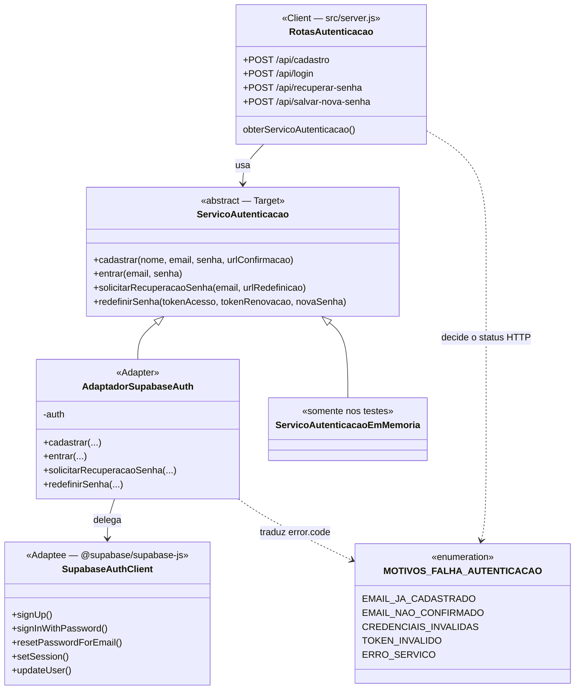
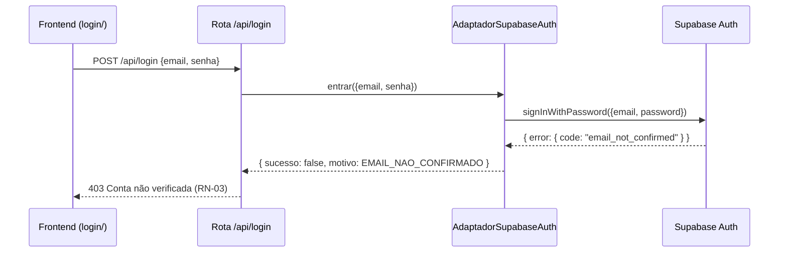

# Padrões de projeto aplicados

> **Artefato central da Sprint 5.** Só registre um padrão quando ele resolver um problema concreto e estiver identificável no código. Não é obrigatório forçar vários padrões.

**Resumo:** um padrão foi aplicado — **Adapter**, isolando o Supabase Auth atrás de uma interface do próprio projeto (`ServicoAutenticacao`). Os demais padrões avaliados e o motivo de não terem sido usados estão na seção 7.

---

## 1. Problema recorrente identificado

O problema foi encontrado em [`src/server.js`](https://github.com/pstehling/tp-eng-software/blob/8e343400d24fbd62b958910466039cedefdacfa2/src/server.js), na versão da `main` antes desta sprint (commit `8e34340`). As quatro rotas do fluxo de autenticação (RF-01, RF-02, RF-03) repetiam o mesmo trecho:

1. obter o cliente do Supabase e verificar se ele existe;
2. chamar diretamente um método do SDK (`supabase.auth.signUp`, `signInWithPassword`, `resetPasswordForEmail`, `setSession`, `updateUser`), montando os parâmetros no formato do Supabase (`password`, `options.emailRedirectTo`, `access_token`, `refresh_token`);
3. interpretar o erro do Supabase **pelo texto em inglês da mensagem** para decidir o código HTTP.

O ponto 3 era o mais frágil. Trechos reais da versão anterior:

```js
// /api/cadastro — linha 69
if (/already registered/i.test(error.message)) {
  return res.status(409).json({ sucesso: false, erro: 'Este e-mail já está cadastrado.' });
}

// /api/login — linha 94 (implementa a RN-03)
if (error.message === 'Email not confirmed') {
  return res.status(403).json({ ... 'Conta não verificada...' });
}
```

Consequências concretas observadas no projeto:

| Sintoma | Onde aparecia | Por que é um problema |
|---|---|---|
| Regra de negócio dependente de texto do fornecedor | Linhas [69](https://github.com/pstehling/tp-eng-software/blob/8e343400d24fbd62b958910466039cedefdacfa2/src/server.js#L69) e [94](https://github.com/pstehling/tp-eng-software/blob/8e343400d24fbd62b958910466039cedefdacfa2/src/server.js#L94) de `server.js` | Se o Supabase mudar a frase (o que não é uma mudança de API), a RN-03 deixa de funcionar **sem nenhum erro**: a conta não verificada passa a receber `401 E-mail ou senha incorretos` em vez de `403 Conta não verificada`. O SDK instalado (`@supabase/auth-js` 2.109.0) já oferece um campo estável para isso, `error.code` (`email_not_confirmed`, `user_already_exists`, `email_exists`), que o código não usava. |
| Conhecimento do SDK espalhado por 4 rotas | 5 chamadas `supabase.auth.*` em `server.js` (linhas [59](https://github.com/pstehling/tp-eng-software/blob/8e343400d24fbd62b958910466039cedefdacfa2/src/server.js#L59), [90](https://github.com/pstehling/tp-eng-software/blob/8e343400d24fbd62b958910466039cedefdacfa2/src/server.js#L90), [116](https://github.com/pstehling/tp-eng-software/blob/8e343400d24fbd62b958910466039cedefdacfa2/src/server.js#L116), [146](https://github.com/pstehling/tp-eng-software/blob/8e343400d24fbd62b958910466039cedefdacfa2/src/server.js#L146), [156](https://github.com/pstehling/tp-eng-software/blob/8e343400d24fbd62b958910466039cedefdacfa2/src/server.js#L156)) | Cada rota acumulava duas responsabilidades: tratar HTTP e conhecer a API do Supabase. Uma mudança no fornecedor obrigava a mexer em todas. |
| Testes presos ao formato do Supabase | [`tests/auth.test.js`](https://github.com/pstehling/tp-eng-software/blob/8e343400d24fbd62b958910466039cedefdacfa2/tests/auth.test.js#L16), função `supabaseFalso` e mensagens nas linhas 73, 79 e 85 | Para testar uma rota, o teste precisava imitar o SDK do Supabase, inclusive as frases em inglês. |

**Por que é recorrente, e não um caso isolado:** o mesmo trecho se repetia nas 4 rotas existentes e voltaria a aparecer nas próximas funcionalidades de conta que ainda estão no backlog e também dependem do Supabase Auth — o **logout** (RF-02, ainda pendente) e a **troca de senha no perfil** (RF-05 / US-04, critério 2).

**Relação com os princípios do Cap. 5:** é um caso de **acoplamento ruim**: as rotas dependiam de detalhes instáveis de outro módulo (o texto das mensagens), e não de uma interface estável. Também violava a **inversão de dependências** ("prefira interfaces a classes": as rotas dependiam da implementação concreta do Supabase), o **ocultamento de informação** (detalhes do fornecedor visíveis em toda a camada de rotas) e a **responsabilidade única** (cada rota tinha dois motivos para mudar: o contrato HTTP e a API do Supabase).

---

## 2. Padrão aplicado

### PP-01 — Adapter (Adaptador)

- **Problema que resolve:** as rotas precisam de "cadastrar, entrar, pedir recuperação e redefinir senha" com resultados no vocabulário do nosso domínio; o Supabase oferece essas operações com outra interface (nomes, parâmetros e erros próprios). O Adapter converte a interface do Supabase na interface que as rotas esperam, num único lugar.
- **Contexto no projeto:** backend Express em `src/server.js`, fluxo "Cadastro, verificação e login" (modelagem, seção 4.1).
- **Participantes do padrão no código:**
  - **Target (alvo):** `ServicoAutenticacao` + `MOTIVOS_FALHA_AUTENTICACAO` — [`src/servicos/servico-autenticacao.js`](../../src/servicos/servico-autenticacao.js)
  - **Adapter:** `AdaptadorSupabaseAuth` — [`src/servicos/adaptador-supabase-auth.js`](../../src/servicos/adaptador-supabase-auth.js)
  - **Adaptee (adaptado):** `SupabaseAuthClient` (`clienteSupabase.auth`, de `@supabase/supabase-js`)
  - **Client:** as rotas `/api/cadastro`, `/api/login`, `/api/recuperar-senha` e `/api/salvar-nova-senha` e a função `obterServicoAutenticacao()` — [`src/server.js`](../../src/server.js)
- **Requisitos relacionados:** `RF-01`, `RF-02`, `RF-03`, `RN-03`, `RNF-02`
- **Issue/PR:** `[PREENCHER — Issue de implementação e validação do padrão]` / `[PREENCHER — PR da branch sprint-05]`

---

## 3. Estrutura do padrão

### 3.1 Diagrama de classes (participantes reais)



### 3.2 Login depois da mudança



A rota decide **o que responder** (status e mensagem em português); o adaptador decide **como falar com o Supabase** e como interpretar o que ele devolve.

---

## 4. Evidência no código

| Papel no padrão | Arquivo/classe/função | Link |
|---|---|---|
| Target | `ServicoAutenticacao` (classe abstrata, mesmo estilo de `ItemDoRepositorio`) e `MOTIVOS_FALHA_AUTENTICACAO` | [`src/servicos/servico-autenticacao.js`](../../src/servicos/servico-autenticacao.js) |
| Adapter | `AdaptadorSupabaseAuth`; tradução de erros em `emailJaCadastrado()` e `emailNaoConfirmado()` | [`src/servicos/adaptador-supabase-auth.js`](../../src/servicos/adaptador-supabase-auth.js) |
| Adaptee | cliente `@supabase/supabase-js` (`createClient`), criado em `obterSupabase()` | [`src/server.js#L20`](../../src/server.js#L20) |
| Client — ponto de criação | `obterServicoAutenticacao()` | [`src/server.js#L32`](../../src/server.js#L32) |
| Client — rotas | `/api/cadastro`, `/api/login`, `/api/recuperar-senha`, `/api/salvar-nova-senha` | [`#L56`](../../src/server.js#L56), [`#L92`](../../src/server.js#L92), [`#L118`](../../src/server.js#L118), [`#L143`](../../src/server.js#L143) |
| Teste do adaptador | 7 testes: tradução de parâmetros e de `error.code`, mesmo com mensagem alterada | [`tests/adaptador-autenticacao.test.js`](../../tests/adaptador-autenticacao.test.js) |
| Teste do cliente com outra implementação | `ServicoAutenticacaoEmMemoria`: as rotas funcionam sem Supabase algum | [`tests/adaptador-autenticacao.test.js`](../../tests/adaptador-autenticacao.test.js) |
| Teste de não regressão | `tests/auth.test.js` **sem nenhuma alteração** continua passando — o Supabase falso agora é chamado através do adaptador | [`tests/auth.test.js`](../../tests/auth.test.js) |

Links fixados na tag (funcionam depois que a tag `sprint-05` for enviada): [`src/servicos/` na tag](https://github.com/pstehling/tp-eng-software/tree/sprint-05/src/servicos), [`src/server.js` na tag](https://github.com/pstehling/tp-eng-software/blob/sprint-05/src/server.js).

### 4.1 Antes e depois

| Aspecto | Antes (`8e34340`) | Depois (`sprint-05`) |
|---|---|---|
| Quem conhece o SDK do Supabase | As 4 rotas de `server.js` (5 chamadas `supabase.auth.*`) | Somente `AdaptadorSupabaseAuth` |
| Como "e-mail já cadastrado" é detectado | `/already registered/i.test(error.message)` | `error.code` ∈ {`user_already_exists`, `email_exists`}; a mensagem só é usada como alternativa quando não há código |
| Como "conta não verificada" (RN-03) é detectada | `error.message === 'Email not confirmed'` | `error.code === 'email_not_confirmed'`, com a mesma alternativa |
| O que a rota recebe | Objeto de erro do Supabase | `{ sucesso, motivo, detalhe }` com `motivo` em `MOTIVOS_FALHA_AUTENTICACAO` (mesmo formato de `validarUpload`) |
| Como testar uma rota | Imitar o SDK do Supabase e suas frases | Injetar qualquer implementação de `ServicoAutenticacao` em `app.locals.servicoAutenticacao` |
| Contrato HTTP com o frontend | status 201/400/401/403/409/503 + `{ sucesso, erro, mensagem, redirecionar }` | **Idêntico** — nenhuma alteração em `src/public/` |

Trecho da rota de login depois da mudança ([`src/server.js#L92`](../../src/server.js#L92)):

```js
const resultado = await servicoAuth.entrar({ email, senha });

if (!resultado.sucesso) {
  if (resultado.motivo === MOTIVOS_FALHA_AUTENTICACAO.EMAIL_NAO_CONFIRMADO) {
    return res.status(403).json({ ... 'Conta não verificada...' });
  }
  return res.status(401).json({ sucesso: false, erro: 'E-mail ou senha incorretos.' });
}
```

### 4.2 Como verificar

```bash
cd src
npm install
npm test     # 44 testes: os 33 anteriores (inalterados) + 11 do padrão
npm start    # http://localhost:3000 — cadastro, login e recuperação de senha
```

| Evidência | Resultado |
|---|---|
| [`docs/evidencias/sprint-05-testes-antes.txt`](../evidencias/sprint-05-testes-antes.txt) | 33 testes, 33 aprovados — código anterior à mudança |
| [`docs/evidencias/sprint-05-testes-depois.txt`](../evidencias/sprint-05-testes-depois.txt) | 44 testes, 44 aprovados — mesmos 33 testes sem alteração + 11 novos |

---

## 5. Alternativas e justificativa

| Alternativa | Vantagem | Limitação no contexto do projeto |
|---|---|---|
| **Não usar padrão:** manter as chamadas nas rotas e só trocar `error.message` por `error.code` | Menor mudança possível; resolveria a fragilidade das mensagens | O conhecimento do SDK continuaria espalhado pelas 4 rotas (e pelas próximas: logout e troca de senha); os testes continuariam imitando o Supabase. Resolve o sintoma, não a causa (acoplamento das rotas ao fornecedor). |
| **Funções utilitárias soltas** (ex.: `traduzirErroSupabase(error)`) chamadas pelas rotas | Centraliza a tradução de erros sem criar classes | As rotas continuariam chamando `supabase.auth.*` e montando parâmetros do Supabase; só metade do acoplamento seria removida. |
| **Facade** | Estrutura de código muito parecida (uma classe que esconde o subsistema) | O objetivo da Facade é simplificar um subsistema complexo; aqui o Supabase já tem uma API simples. O problema real é de **conversão**: nomes, parâmetros e erros do fornecedor para o vocabulário do domínio, definido pelo lado de quem usa (as rotas). Por isso o padrão que descreve a intenção é o Adapter. |
| **Adapter** (escolhida) | Um único ponto conhece o Supabase; erros traduzidos por código estável; rotas e testes dependem de uma interface nossa | Custo de dois arquivos novos e de uma indireção (seção 6). |

**Justificativa da escolha:** o Adapter é a forma mais direta de cumprir a recomendação do Cap. 5 de "depender de interfaces estáveis" sem alterar o fornecedor nem o contrato com o frontend. A interface foi desenhada a partir do que as rotas precisam (Target definido pelo cliente), e não copiando a API do Supabase.

---

## 6. Resultado observado

**Benefícios verificados:**

- **A RN-03 deixou de depender de uma frase em inglês.** O teste "conta não confirmada é reconhecida pelo código do erro" usa `{ code: 'email_not_confirmed', message: 'Outro texto' }` e passa; no código anterior essa situação resultaria em `401` em vez de `403`.
- **Ponto único de mudança.** Se o Supabase mudar algo, ou se o grupo trocar de provedor, só `adaptador-supabase-auth.js` muda; as rotas, o frontend e os testes das rotas não.
- **Rotas testáveis sem o Supabase.** `ServicoAutenticacaoEmMemoria` (nos testes) implementa a interface e exercita cadastro, e-mail repetido, conta pendente, login, senha errada e redefinição de senha pelas rotas reais.
- **Comportamento preservado.** Os 33 testes anteriores, incluindo `tests/auth.test.js` sem nenhuma alteração, continuam passando; nenhum arquivo de `src/public/` foi alterado.
- **Coesão das rotas.** Cada rota agora só valida a entrada, chama a interface e escolhe a resposta HTTP.

**Custos:**

- Dois arquivos novos (~130 linhas, com comentários) e uma camada de indireção a mais para quem lê o fluxo pela primeira vez.
- `MOTIVOS_FALHA_AUTENTICACAO` precisa ser mantido: um novo tipo de falha que a rota precise tratar exige mexer na interface, no adaptador e na rota.

**Limitações conhecidas:**

- **JavaScript não tem interfaces.** `ServicoAutenticacao` é uma classe abstrata verificada em tempo de execução (`new.target`, como já é feito em `ItemDoRepositorio`). Uma implementação que esqueça um método só falha quando ele for chamado; quem garante o contrato são os testes.
- **A interface foi desenhada com os fluxos do Supabase em mente** (link de confirmação por e-mail, token de sessão na redefinição). Um provedor com fluxo muito diferente poderia exigir mudar a interface, não só criar outro adaptador.
- **Falha de rede no login continua virando `401 E-mail ou senha incorretos`.** Esse era o comportamento anterior e foi mantido de propósito para não alterar o contrato nesta sprint. Agora a correção ficou localizada (bastaria o adaptador devolver `ERRO_SERVICO` para erros de rede), mas a mudança de comportamento precisa ser decidida pelo grupo — ver item no backlog.
- A tradução ainda usa a mensagem como alternativa quando o erro não tem `code`, para continuar compatível com o Supabase falso de `tests/auth.test.js` e com respostas sem código. Essa alternativa fica restrita ao adaptador.

---

## 7. Padrões avaliados e não aplicados

| Padrão | Por que não foi necessário ou adequado |
|---|---|
| **Strategy** (ex.: trocar o provedor de IA do RF-10) | O RF-10 ainda não tem código; não existe hoje algoritmo variando em tempo de execução. Aplicar agora seria otimização prematura. O mesmo raciocínio deste documento (interface + adaptador) pode ser reaproveitado quando o chat com IA for implementado. |
| **Singleton** (cliente do Supabase) | `obterSupabase()` já cria o cliente sob demanda e reaproveita a mesma instância. Um Singleton formal dificultaria a injeção de dublês nos testes (`app.locals`), que é justamente o que os testes usam. |
| **Factory / Factory Method** (para criar o serviço de autenticação) | Há uma só implementação de produção. A escolha cabe em uma função de 4 linhas (`obterServicoAutenticacao()`); uma hierarquia de fábricas não traria benefício. |
| **Facade** | Discutido na seção 5: a estrutura seria parecida, mas a intenção do problema é conversão de interface, não simplificação de um subsistema complexo. |
| **Template Method** (validações de cadastro, senha e upload) | As validações em `src/models/` são funções curtas com regras diferentes entre si; não há um algoritmo comum com passos variáveis que justifique uma classe base. |
| **Decorator / Proxy** (ex.: log ou cache das chamadas de autenticação) | Não há requisito de log, cache ou controle de acesso sobre essas chamadas hoje. |
